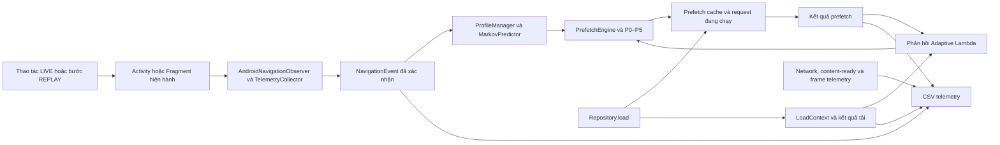

# Kiến trúc hệ thống cuối kỳ

Hệ thống dùng telemetry theo hai cách. Khi ứng dụng chạy, các chuyển màn hình đã xác nhận cập nhật Markov và hỗ trợ quyết định prefetch. Trên máy phát triển, CSV từ các run hợp lệ giúp chọn hành trình để thu Android Profile, build APK và kiểm tra lại bằng workload. Adaptive Lambda điều chỉnh chi phí prefetch theo phản hồi runtime. Baseline Profile và Startup Profile tác động đến code loading thông qua ART và DEX layout.

## Luồng từ điều hướng tới tải dữ liệu

| Thành phần | Trách nhiệm và điểm đọc source |
|---|---|
| Khởi tạo | `MyApplication.onCreate()` tạo `AppContainer`, đăng ký Activity lifecycle và checkpoint khi ứng dụng xuống background. `AppContainer` nối event đã xác nhận tới `ProfileManager.onNavigationEvent()` và `MetricsLogger.recordNavigation()`. [MyApplication](../app/src/main/java/com/socialapp/MyApplication.java) · [AppContainer](../app/src/main/java/com/socialapp/core/di/AppContainer.java) |
| Navigation telemetry | `AndroidNavigationObserver.confirmResumedScreen()` kiểm tra Activity hiện hành hoặc destination và trạng thái Feed của Home. `TelemetryCollector` lọc đích trùng, ngắt chuỗi ở màn hình ngoài phạm vi và phát event có run, session, sequence, navigation ID, nguồn và mốc monotonic. `SessionTracker` dùng 30 phút cho LIVE và nhận ranh giới session từ trace cho REPLAY. [Observer](../app/src/main/java/com/socialapp/core/telemetry/AndroidNavigationObserver.java) · [Collector](../app/src/main/java/com/socialapp/core/telemetry/TelemetryCollector.java) · [SessionTracker](../app/src/main/java/com/socialapp/core/telemetry/SessionTracker.java) |
| Replay | `ReplayEngine.parseSessions()` đọc asset theo `ScreenId.fromReplayId()`. Khi chạy, Replay yêu cầu `Navigator` mở route, chờ observer trả về đúng đích rồi mới bắt đầu dwell. Sai đích hoặc timeout làm run không hợp lệ. Kết thúc run tạo snapshot kết quả và ghi `RUN_END` cùng số bước xác nhận, số event và trạng thái export. Một bước xác nhận lại cùng đích có thể không phát thêm NavigationEvent. [ReplayEngine](../app/src/main/java/com/socialapp/core/prefetch/ReplayEngine.java) · [ScreenId](../app/src/main/java/com/socialapp/core/prefetch/ScreenId.java) · [Navigator](../app/src/main/java/com/socialapp/core/navigation/Navigator.java) |
| Markov Prediction | `PrefetchEngine.onNavigationEvent()` nhận event đã xác nhận, kiểm tra session và sequence, cập nhật context rồi dự đoán. `MarkovPredictor.learn()` cộng transition counts theo suffix dài 1 và 2. `predict()` dùng bậc cao nhất đủ `minSupport`, backoff về bậc thấp hơn và tính xác suất bằng count đích chia tổng count của context. Khi bằng count, thứ tự theo tên đích. Màn đầu phiên tạo context. History được ngắt khi đổi session hoặc chuỗi, còn counts tiếp tục tích lũy trong cùng run. [PrefetchEngine](../app/src/main/java/com/socialapp/core/prefetch/PrefetchEngine.java) · [MarkovPredictor](../app/src/main/java/com/socialapp/core/prefetch/policy/markov/MarkovPredictor.java) |
| Navigation Profile Persistence | `NavigationProfile` là snapshot transition counts có schema version và profile version. `ProfileStore` lưu JSON vào internal storage qua executor. `ProfileManager.beginReplay()` checkpoint LIVE và khởi tạo model thử nghiệm từ warm-start. `endReplay()` khôi phục snapshot LIVE. History, cache và request đang chạy thuộc runtime. [NavigationProfile](../app/src/main/java/com/socialapp/core/prefetch/profile/NavigationProfile.java) · [ProfileManager](../app/src/main/java/com/socialapp/core/prefetch/profile/ProfileManager.java) · [ProfileStore](../app/src/main/java/com/socialapp/core/prefetch/profile/ProfileStore.java) |
| Prefetch, cache và data load | Prediction chạy khi navigation được xác nhận. `Repository.load()` capture run/session ở thời điểm bắt đầu và liên kết navigation ID khi có bằng chứng. Request hoàn thành muộn vẫn được quy thuộc theo context ban đầu. Foreground có thể dùng entry đã hoàn tất (`FULL_HIT`), chờ prefetch đang chạy (`LATE_HIT`) hoặc tải theo đường miss (`MISS`). TTL, eviction và cuối session chốt waste cho entry chưa dùng. Cache generation chặn callback của phạm vi cũ. Refresh, retry và callback tải dữ liệu chỉ đi qua pipeline tải và metrics. [Repository](../app/src/main/java/com/socialapp/core/prefetch/Repository.java) · [LoadContext](../app/src/main/java/com/socialapp/core/telemetry/LoadContext.java) · [PrefetchCache](../app/src/main/java/com/socialapp/core/prefetch/PrefetchCache.java) |
| Adaptive Lambda | P0 tắt prefetch. P5 có Legacy, Fixed và Adaptive cho Replay. Fixed và Adaptive chọn ứng viên có utility dương `p × T_est − λ × B`. `P5Experiment` gom phản hồi từ foreground thành công và các prefetch đã chốt used/wasted. `AdaptiveLambdaController.evaluate()` thay đổi λ theo từng cửa sổ đủ mẫu. P5 ở LIVE sử dụng Legacy. [PrefetchEngine](../app/src/main/java/com/socialapp/core/prefetch/PrefetchEngine.java) · [P5Experiment](../app/src/main/java/com/socialapp/core/prefetch/P5Experiment.java) · [AdaptiveLambdaController](../app/src/main/java/com/socialapp/core/prefetch/AdaptiveLambdaController.java) |

Với cấu hình đã chốt, λ khởi tạo ở `0.000075 ms/B`, giới hạn trong `[0.000015, 0.004]`. Mỗi cửa sổ có 8 foreground load thành công và yêu cầu tối thiểu 3 mẫu prefetch đã chốt. Waste trên 35% làm λ nhân 1,2. Waste dưới 25% đồng thời miss trên 50% làm λ nhân 0,8. Các trường hợp khác giữ nguyên λ. Waste cuối run vẫn thuộc tổng kết ngay cả khi cửa sổ còn thiếu foreground load để cập nhật controller.

## Dữ liệu xuất và quyết định build

| Dữ liệu hoặc bước | Vai trò |
|---|---|
| `navigation_v1.csv` | Chuỗi đích đã xác nhận theo run và session. Dùng để đếm tần suất và transition trong session. |
| `metrics_v2_*.csv`, `p5_v1.csv` | Foreground load, cache waste và trạng thái run. Dòng P5 bổ sung quyết định theo ứng viên, kết quả theo `prefetch_id` và các lần quan sát λ. |
| `performance_v1.csv` | Network call, content-ready và frame telemetry. Chỉ quy số đo về hành trình khi dữ liệu có correlation phù hợp. `LIVE`/`REPLAY` mô tả nguồn hành vi, `REAL`/`SIMULATED` mô tả nguồn phép đo mạng. |
| `pull_metrics.ps1` và `analyze_metrics.ps1` | Kéo CSV theo package vào thư mục export mới rồi tổng hợp prefetch, performance và journey. Logcat hỗ trợ chẩn đoán và đối chiếu terminal. |
| Journey ranking | Pipeline chỉ nhận run hiệu chỉnh hợp lệ, đối chiếu `RUN_END`, số event và chuỗi session, loại trùng session giữa các run. Tập ứng viên là các hành trình đã xác minh trong catalog. Xếp theo tần suất giảm dần và Journey ID tăng dần khi hòa. Startup bắt buộc, ngân sách sau startup là K=2. |
| Manifest và generator | `select_profile_journeys.ps1` chuyển Journey ID thành bộ lọc test method. `BaselineProfileGenerator` chạy hành trình bằng UI Automator với guest, fixture local và P0. Chỉ test startup bật `includeInStartupProfile`. |
| Xuất bản generation | `run_continuous_profile_pipeline.ps1` so fingerprint đầu vào để quyết định `REUSE` hoặc `REGENERATE`. Nhánh sinh mới thu vào thư mục riêng, kiểm tra đúng tập profile đầu vào, merge trong bản sao build tách biệt, build APK và đối soát binary profile với DEX. Sau khi cài đúng APK, pipeline xác minh ProfileInstaller và ART. |
| Feedback | Replay trên APK đã áp dụng profile tạo CSV mới. Pipeline nhận run UUID được chỉ định và đưa ra quyết định cho lượt tiếp theo. T6.D.1 dùng session 12 như cửa sổ riêng để tránh đếm trùng tập hiệu chỉnh. |

Điểm đọc source cho phần này gồm [TelemetryCsvWriter](../app/src/main/java/com/socialapp/core/telemetry/TelemetryCsvWriter.java), [PerformanceTelemetry](../app/src/main/java/com/socialapp/core/telemetry/PerformanceTelemetry.java), [workload manifest](../scripts/replay_workload_t3.json), [Journey Catalog](../baselineprofile/journey-catalog.json), [script chọn hành trình](../scripts/select_profile_journeys.ps1), [generator](../baselineprofile/src/main/java/com/socialapp/baselineprofile/BaselineProfileGenerator.java), [pipeline](../scripts/run_continuous_profile_pipeline.ps1) và [script build artifact](../scripts/continuous_profile_artifacts.ps1).

## Ba loại profile trong hệ thống

| Profile | Nội dung | Thời điểm sử dụng |
|---|---|---|
| Navigation Profile | Transition counts Markov trong JSON. | Runtime. Persistence phục vụ LIVE. |
| Baseline Profile | Quy tắc class/method của startup và các hành trình sau startup đã chọn. | Đóng gói theo DEX của APK. ProfileInstaller và ART sử dụng profile để biên dịch theo profile. |
| Startup Profile | Quy tắc từ lần thu startup qua launcher. | Build-time. D8 dùng làm đầu vào sắp xếp DEX khi cấu hình bật. |

Baseline Profile cần phân biệt bốn trạng thái kiểm chứng gồm đã sinh, đã đóng gói, đã cài và ART đã biên dịch. Startup thực tế đi qua launcher và Feed Newest sẵn sàng, có mốc `reportFullyDrawn()` dùng trong Macrobenchmark. Bước đầu của một Replay session là ranh giới workload. Vòng feedback thực hiện phân tích, thu profile và build trên máy phát triển theo các bước riêng, rồi triển khai APK lên thiết bị. [Cấu hình Android build](../app/build.gradle) · [Macrobenchmark](../baselineprofile/src/main/java/com/socialapp/baselineprofile/BaselineProfileBenchmark.java) · [HomeActivity](../app/src/main/java/com/socialapp/feature/home/HomeActivity.java)

Hai file profile chính thức T5 nằm trong source set release. APK feedback dùng profile mới được merge và build trong bản sao tách biệt, từ selection đã chốt của chính generation đó. [Baseline Profile T5](../app/src/release/generated/baselineProfiles/baseline-prof.txt) · [Startup Profile T5](../app/src/release/generated/baselineProfiles/startup-prof.txt) · [Provenance của APK feedback](../build/t6d1/20261126_095722-feedback/generation-011/collection-provenance.json)

## Giới hạn nghiên cứu

- Hành vi quan sát chủ yếu đến từ Replay tổng hợp. LIVE minh họa hệ thống khi thao tác trực tiếp. Phạm vi xác minh hiện tại là môi trường nghiên cứu và chưa có kiểm chứng production.
- Benchmark chạy trên emulator. Smoke Startup Profile chứng minh thay đổi DEX layout, với dữ liệu đo hiện có chưa đủ bằng chứng cải thiện startup.
- Journey Catalog bao phủ một phần workload. Độ bao phủ transition mô tả cặp màn hình đã chọn.
- Telemetry writer dùng hàng đợi có giới hạn, một consumer và các vùng đồng bộ `synchronized`. Thiết kế hiện tại chưa phải lock-free.
- Navigation Profile persistence áp dụng cho LIVE. Replay dùng model thực nghiệm cô lập.
- T6.D.1 dùng `-ForceRegenerate` để kiểm chứng kỹ thuật. APK feedback áp dụng Baseline Profile và tắt Startup Profile trong DEX layout.

Xem [kết quả thực nghiệm](final-experiment-results.md) và [kịch bản demo](demo-guide.md).
