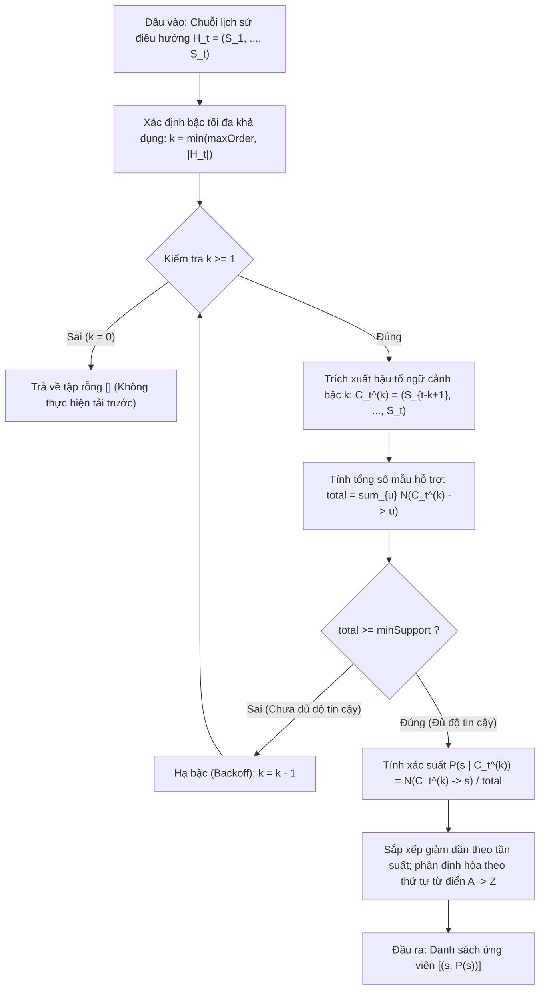
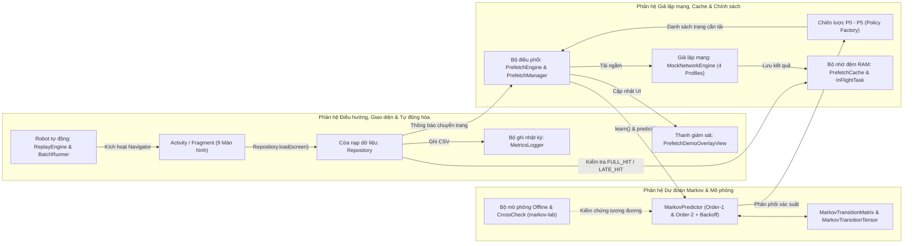
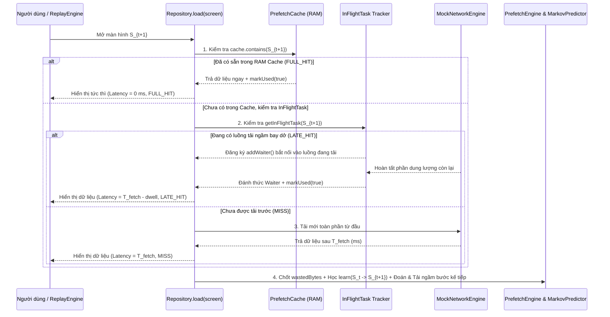

# BÁO CÁO ĐỒ ÁN MÔN HỌC

**ĐỀ TÀI:**
**NGHIÊN CỨU VÀ XÂY DỰNG HỆ THỐNG DỰ ĐOÁN HÀNH VI ĐIỀU HƯỚNG NGƯỜI DÙNG BẰNG MÔ HÌNH CHUỖI MARKOV ĐA BẬC KẾT HỢP TẢI TRƯỚC THÍCH ỨNG MẠNG TRÊN ỨNG DỤNG DI ĐỘNG ANDROID**

---

## LỜI NÓI ĐẦU

Trong kỷ nguyên bùng nổ của các ứng dụng di động thông minh, tốc độ phản hồi giao diện khi người dùng chuyển đổi giữa các màn hình chức năng là một trong những yếu tố quyết định trực tiếp đến chất lượng trải nghiệm người dùng (Quality of Experience – QoE). Tuy nhiên, trên các mạng không dây di động có độ trễ cao và băng thông biến động như 3G hoặc ở vùng sóng yếu (EDGE/2G), việc ứng dụng chỉ bắt đầu tải dữ liệu sau khi người dùng đã chạm tay vào màn hình (reactive fetching) thường gây ra độ trễ chờ đợi kéo dài từ vài trăm mili-giây đến hàng giây.

Xuất phát từ thực tế đó, nhóm thực hiện đề tài **“Nghiên cứu và xây dựng hệ thống dự đoán hành vi điều hướng người dùng bằng mô hình Chuỗi Markov đa bậc kết hợp tải trước thích ứng mạng trên ứng dụng di động Android”**. Đề tài tập trung giải quyết bài toán tận dụng khoảng thời gian nhàn rỗi khi người dùng đang đọc nội dung trên màn hình hiện tại (dwell time) để dự đoán xác suất màn hình kế tiếp và chủ động tải ngầm dữ liệu (proactive prefetching) vào bộ nhớ đệm, đồng thời kiểm soát chặt chẽ lượng băng thông tiêu thụ dư thừa.

Báo cáo trình bày một cách hệ thống từ cơ sở lý thuyết về Chuỗi Markov đa bậc có hạ bậc (All-$k$-th-Order Markov Model with Backoff), mô hình kinh tế mạng trong quyết định tải trước, đến thiết kế kiến trúc, cài đặt thực tế trên ứng dụng mạng xã hội kiểm chứng thông tin (`SocialApp`) và các kết quả thực nghiệm định lượng.

Nhóm xin chân thành cảm ơn Giảng viên hướng dẫn đã định hướng phương pháp nghiên cứu, thiết kế thực nghiệm và góp ý chuyên môn trong suốt quá trình thực hiện đề tài.

---

## TÓM TẮT ĐỒ ÁN (ABSTRACT)

Độ trễ mạng trên thiết bị di động là rào cản lớn đối với trải nghiệm tương tác thời gian thực. Báo cáo này trình bày thiết kế và hiện thực hóa một hệ thống tải trước dữ liệu màn hình (screen-level prefetching) dựa trên mô hình học trực tuyến hành vi điều hướng của người dùng. Hệ thống bao gồm ba thành phần cốt lõi: (1) Bộ dự đoán chuỗi Markov đa bậc có hạ bậc (`MarkovPredictor`) với ngưỡng hỗ trợ tối thiểu ($\text{minSupport} = 3$) nhằm giải quyết đồng thời bài toán phụ thuộc ngữ cảnh nhiều bước và hiện tượng thưa dữ liệu ban đầu (cold-start); (2) Hạ tầng quản lý bộ nhớ đệm RAM (`PrefetchCache`) hỗ trợ thời gian sống (TTL), thu hồi LRU, bắt nối các yêu cầu đang tải dở (`LATE_HIT`) và bộ giả lập mạng có chia sẻ băng thông (`MockNetworkEngine`) cùng 6 chiến lược tải trước (`P0`–`P5`); và (3) Kiến trúc điều phối dữ liệu trung tâm (`Repository`), giao diện giám sát trực quan thời gian thực (`PrefetchDemoOverlayView`) và bộ chạy kịch bản tự động (`ReplayEngine`, `BatchExperimentRunner`). Kết quả kiểm tra chéo trên tập dữ liệu $1000$ phiên ($8932$ bước chuyển màn hình) và thực nghiệm $100$ phiên trên ứng dụng Android cho thấy mô hình Markov bậc 2 có hạ bậc đạt độ chính xác dự đoán Top-1 từ $57.56\%$ đến $61.50\%$, giúp giảm từ $57.8\%$ đến $77.3\%$ độ trễ chờ đợi trung bình của người dùng trên mạng 3G và EDGE với chi phí băng thông dư thừa nằm trong ngưỡng tối ưu Pareto.

---

## MỤC LỤC

- **LỜI NÓI ĐẦU**
- **TÓM TẮT ĐỒ ÁN**
- **DANH MỤC TỪ VIẾT TẮT**
- **DANH MỤC BẢNG BIỂU VÀ HÌNH VẼ**
- **CHƯƠNG 1: TỔNG QUAN VỀ ĐỀ TÀI**
  - 1.1. Đặt vấn đề và bối cảnh nghiên cứu
  - 1.2. Mục tiêu của đề tài
  - 1.3. Đối tượng và phạm vi nghiên cứu
  - 1.4. Phương pháp nghiên cứu và thực nghiệm
  - 1.5. Bố cục của báo cáo
- **CHƯƠNG 2: CƠ SỞ LÝ THUYẾT**
  - 2.1. Tổng quan về kỹ thuật tải trước dữ liệu (Prefetching) trên thiết bị di động
  - 2.2. Lý thuyết Chuỗi Markov và mô hình dự đoán điều hướng bậc $k$
  - 2.3. Kỹ thuật hạ bậc (Backoff) và giải quyết bài toán khởi đầu lạnh (Cold-start)
  - 2.4. Mô hình hóa độ trễ mạng, chia sẻ băng thông và lý thuyết tối ưu hóa lợi ích – chi phí (Pareto Utility)
- **CHƯƠNG 3: PHÂN TÍCH VÀ THIẾT KẾ HỆ THỐNG**
  - 3.1. Phân tích yêu cầu hệ thống
  - 3.2. Kiến trúc tổng thể hệ thống
  - 3.3. Thiết kế phân hệ dự đoán hành vi điều hướng Markov
  - 3.4. Thiết kế phân hệ giả lập mạng, quản lý bộ nhớ đệm và các chiến lược tải trước
  - 3.5. Thiết kế phân hệ điều phối dữ liệu trung tâm, giám sát trực quan và tự động hóa thực nghiệm
- **CHƯƠNG 4: THỰC NGHIỆM VÀ ĐÁNH GIÁ KẾT QUẢ**
  - 4.1. Thiết lập môi trường và bộ dữ liệu thực nghiệm
  - 4.2. Kết quả kiểm thử đơn vị và kiểm tra chéo đa nền tảng (Cross-Check)
  - 4.3. Kết quả mô phỏng Offline: Đường cong học và phân tích biên Pareto
  - 4.4. Kết quả thực nghiệm tích hợp trên ứng dụng Android
  - 4.5. Thảo luận và đánh giá tổng hợp
- **CHƯƠNG 5: KẾT LUẬN VÀ HƯỚNG PHÁT TRIỂN**
  - 5.1. Kết luận và các kết quả đạt được
  - 5.2. Hạn chế của đề tài
  - 5.3. Hướng phát triển trong tương lai
- **TÀI LIỆU THAM KHẢO**
- **PHỤ LỤC: PHÂN CÔNG CÔNG VIỆC TRONG NHÓM (A – B – C)**

---

## DANH MỤC TỪ VIẾT TẮT

| Từ viết tắt | Thuật ngữ tiếng Anh | Giải nghĩa tiếng Việt |
| :--- | :--- | :--- |
| **BW** | Bandwidth | Băng thông đường truyền mạng |
| **LRU** | Least Recently Used | Thuật toán thay thế phần tử ít được sử dụng gần nhất |
| **MLE** | Maximum Likelihood Estimation | Ước lượng hợp lý cực đại |
| **QoE** | Quality of Experience | Chất lượng trải nghiệm người dùng |
| **RTT** | Round-Trip Time | Thời gian khứ hồi của gói tin trên mạng |
| **TTL** | Time-To-Live | Thời gian sống (hiệu lực) của dữ liệu trong bộ nhớ đệm |

---

## DANH MỤC BẢNG BIỂU VÀ HÌNH VẼ

**Danh mục Bảng biểu:**
- **Bảng 3.1**: Danh mục các màn hình chức năng và dung lượng tải cơ sở trong ứng dụng thực nghiệm.
- **Bảng 3.2**: Thông số kỹ thuật của 4 hồ sơ mạng di động trong bộ giả lập mạng.
- **Bảng 3.3**: Đặc tả 6 chiến lược tải trước (`P0` đến `P5`) được cài đặt trong hệ thống.
- **Bảng 4.1**: Kết quả thực thi 6 kịch bản kiểm thử đơn vị (Unit Test) của bộ dự đoán Markov.
- **Bảng 4.2**: Kết quả kiểm tra chéo (Cross-Check) giữa Java và Python trên 1000 phiên người dùng.
- **Bảng 4.3**: Tổng hợp kết quả mô phỏng Offline trên 4 hồ sơ mạng với tập dữ liệu 1000 phiên.
- **Bảng 4.4**: Kết quả thực nghiệm 100 phiên điều hướng trên ứng dụng Android `SocialApp`.

**Danh mục Hình vẽ:**
- **Hình 2.1**: Sơ đồ thuật toán dự đoán Markov đa bậc có hạ bậc (All-$k$-th-Order Markov with Backoff).
- **Hình 3.1**: Sơ đồ kiến trúc tổng thể 3 phân hệ của hệ thống.
- **Hình 3.2**: Sơ đồ tuần tự xử lý 3 trạng thái truy xuất (`FULL_HIT`, `LATE_HIT`, `MISS`).
- **Hình 4.1**: Biểu đồ đường cong học (Learning Curve) của mô hình Markov bậc 1 và bậc 2 (`learning_curve.png`).
- **Hình 4.2**: Biểu đồ biên Pareto đánh đổi giữa độ trễ và băng thông lãng phí trên mạng 3G (`pareto_3g.png`).

---

## CHƯƠNG 1: TỔNG QUAN VỀ ĐỀ TÀI

### 1.1. Đặt vấn đề và bối cảnh nghiên cứu
Trên các ứng dụng di động hướng nội dung như mạng xã hội, thương mại điện tử hay báo điện tử, quá trình sử dụng của người dùng bản chất là một chuỗi các thao tác chuyển đổi qua lại giữa các màn hình chức năng (ví dụ: từ màn hình Bảng tin sang Chi tiết bài viết, sang Bình luận, sang Trang cá nhân hoặc Kiểm chứng thông tin). Theo cơ chế nạp dữ liệu truyền thống theo yêu cầu (on-demand / reactive fetching), ứng dụng chỉ bắt đầu khởi tạo yêu cầu mạng sau khi người dùng đã thực hiện thao tác chạm lên giao diện.

Cơ chế truyền thống này bộc lộ hai điểm nghẽn lớn:
1. **Độ trễ cảm nhận cao trên mạng di động**: Trên các kết nối mạng có thời gian khứ hồi (RTT) lớn và băng thông hạn chế (như mạng 3G với $\text{RTT} \approx 150\text{--}180\text{ ms}$, băng thông $1.5\text{--}2.0\text{ Mbps}$, hoặc mạng EDGE/2G ở vùng sóng yếu), việc tải một màn hình có dung lượng từ $150\text{ KB}$ đến $400\text{ KB}$ buộc người dùng phải chờ đợi từ $1.0$ đến hơn $2.3$ giây trước khi nội dung hiển thị hoàn chỉnh.
2. **Lãng phí thời gian nhàn rỗi của đường truyền (Idle Dwell Time)**: Giữa hai lần chuyển màn hình liên tiếp, người dùng luôn cần một khoảng thời gian dừng lại để quan sát và đọc nội dung trên màn hình hiện tại (gọi là *dwell time*, thường dao động từ $1500\text{ ms}$ đến $5000\text{ ms}$). Trong suốt khoảng thời gian này, kết nối mạng của ứng dụng hoàn toàn không được sử dụng.

Kỹ thuật **Tải trước dữ liệu dự đoán (Predictive Prefetching)** giải quyết điểm nghẽn trên bằng cách dự đoán màn hình mà người dùng có khả năng cao sẽ mở tiếp theo và tải ngầm dữ liệu vào bộ nhớ đệm (RAM Cache) ngay trong khoảng thời gian người dùng đang đọc màn hình hiện tại. Tuy nhiên, thách thức cốt lõi của kỹ thuật này là sự đánh đổi (trade-off) giữa **mức giảm độ trễ** và **chi phí băng thông lãng phí**: nếu dự đoán sai hoặc tải trước quá nhiều màn hình khi mạng đang yếu, ứng dụng không những tiêu tốn dung lượng dữ liệu di động vô ích mà còn gây nghẽn chính đường truyền mạng của màn hình người dùng thực sự mở.

### 1.2. Mục tiêu của đề tài
Đề tài hướng tới việc xây dựng một hệ thống dự đoán điều hướng và tải trước thích ứng hoàn chỉnh từ mô hình lý thuyết, kiểm chứng mô phỏng đến tích hợp trên ứng dụng Android thực tế, với 4 mục tiêu cụ thể:
1. Nghiên cứu và cài đặt bộ dự đoán **Chuỗi Markov đa bậc có hạ bậc (`MarkovPredictor`)** có khả năng học trực tuyến (online learning) thói quen điều hướng của người dùng, tự động kết hợp độ chính xác ngữ cảnh của mô hình bậc 2 với độ phủ dữ liệu của mô hình bậc 1 thông qua ngưỡng hỗ trợ tối thiểu ($\text{minSupport} = 3$).
2. Xây dựng bộ công cụ mô phỏng độc lập và kiểm tra chéo (Cross-Check) đảm bảo tính đồng nhất tuyệt đối giữa mô hình đánh giá bằng Python và mô hình nhúng bằng Java trên Android, từ đó phân tích đường cong học (Learning Curve) và xác định vùng tham số tối ưu trên biên Pareto (Pareto Frontier).
3. Thiết kế hạ tầng tải trước trên Android hỗ trợ giả lập 4 hồ sơ mạng di động (`WiFi`, `4G/LTE`, `3G`, `2G/EDGE`) có chia sẻ băng thông đồng thời, quản lý bộ nhớ đệm RAM có thời gian sống (TTL), cơ chế bắt nối yêu cầu đang bay (`LATE_HIT`) và 6 chiến lược tải trước (`P0`–`P5`).
4. Tích hợp hệ thống vào một ứng dụng Android thực tế (`SocialApp`) kèm theo cửa nạp dữ liệu tập trung (`Repository`), thanh giám sát thời gian thực (`Overlay`) và robot điều hướng tự động (`ReplayEngine`) để đánh giá thực nghiệm một cách khách quan, minh bạch.

### 1.3. Đối tượng và phạm vi nghiên cứu
- **Đối tượng nghiên cứu**:
  - Các mô hình xác suất dự đoán chuỗi trạng thái hữu hạn (Chuỗi Markov bậc 1, bậc 2 và kỹ thuật làm mịn hạ bậc Katz/Count Backoff).
  - Các chiến lược quyết định tải trước dựa trên ngưỡng xác suất và dựa trên hàm lợi ích kinh tế mạng (Utility-based Adaptive Prefetching).
  - Cơ chế quản lý bộ nhớ đệm ngắn hạn trong RAM và hợp nhất yêu cầu mạng trùng lặp (in-flight request coalescing).
- **Phạm vi nghiên cứu**:
  - Dự đoán và tải trước ở **cấp độ màn hình chức năng (Screen-level Prefetching)** trên hệ điều hành Android.
  - Đánh giá trên tập dữ liệu hành vi tổng hợp có kiểm soát ($50$ đến $1000$ phiên người dùng) và kịch bản điều hướng $100$ phiên trên ứng dụng mạng xã hội gồm $9$ màn hình chức năng.

### 1.4. Phương pháp nghiên cứu và thực nghiệm
Đề tài áp dụng phương pháp nghiên cứu kết hợp giữa **Mô phỏng định lượng (Offline Trace-driven Simulation)** và **Thực nghiệm hệ thống thực tế (In-App Automated Replay Benchmarking)**:
1. **Giai đoạn 1 — Kiểm chứng thuật toán và mô phỏng Offline**: Phát triển bộ dự đoán độc lập nền tảng, kiểm tra tính đúng đắn qua các bài toán tính tay, kiểm thử đơn vị (Unit Test) và đối chiếu kết quả từng bước giữa Java và Python trên tập dữ liệu $1000$ phiên trước khi tích hợp vào ứng dụng.
2. **Giai đoạn 2 — Tích hợp và đo lường tự động trên Android**: Để loại bỏ sai số chủ quan khi thao tác bằng tay, hệ thống sử dụng một Robot điều hướng tự động (`ReplayEngine`) đọc kịch bản cố định và tự động kích hoạt chuyển màn hình theo đúng thời gian dừng của từng bước qua cả 6 chính sách và 4 hồ sơ mạng.

### 1.5. Bố cục của báo cáo
Ngoài phần Mở đầu, Kết luận và Tài liệu tham khảo, nội dung chính của báo cáo được tổ chức thành 5 chương:
- **Chương 1 — Tổng quan về đề tài**: Trình bày bối cảnh, mục tiêu, phạm vi và phương pháp nghiên cứu.
- **Chương 2 — Cơ sở lý thuyết**: Trình bày nền tảng toán học của Chuỗi Markov đa bậc có hạ bậc, mô hình độ trễ mạng chia sẻ băng thông và lý thuyết tối ưu hóa lợi ích – chi phí tải trước.
- **Chương 3 — Phân tích và thiết kế hệ thống**: Trình bày kiến trúc tổng thể và thiết kế chi tiết của 3 phân hệ trong ứng dụng.
- **Chương 4 — Thực nghiệm và đánh giá kết quả**: Trình bày kết quả kiểm tra chéo, phân tích đường cong học, biên Pareto và kết quả thực nghiệm trên ứng dụng Android.
- **Chương 5 — Kết luận và hướng phát triển**: Tổng kết các đóng góp của đề tài, hạn chế và hướng nghiên cứu tiếp theo.

---

## CHƯƠNG 2: CƠ SỞ LÝ THUYẾT

### 2.1. Tổng quan về kỹ thuật tải trước dữ liệu (Prefetching) trên thiết bị di động
Trong kiến trúc ứng dụng khách – chủ (client–server), độ trễ hiển thị màn hình mà người dùng cảm nhận là khoảng thời gian từ lúc người dùng thực hiện thao tác chuyển màn hình ($t_{\text{nav}}$) cho đến khi dữ liệu của màn hình mới được tải về đầy đủ và dựng xong trên giao diện ($t_{\text{ready}}$).

Khác với kỹ thuật lưu trữ đệm thụ động (passive caching — chỉ lưu lại những màn hình người dùng đã từng đi qua), kỹ thuật **tải trước chủ động (proactive prefetching)** tận dụng khoảng thời gian dừng $d_t$ khi người dùng đang xem màn hình hiện tại $S_t$ để tải trước dữ liệu của màn hình dự kiến $S_{t+1}$. Hiệu quả của một hệ thống tải trước được quyết định bởi hai yếu tố:
1. **Độ chính xác của bộ dự đoán (Prediction Accuracy)**: Tỷ lệ dự đoán trúng màn hình tiếp theo mà người dùng thực sự mở.
2. **Sự hợp lý của chính sách kích hoạt (Prefetching Policy)**: Quyết định khi nào nên tải, tải bao nhiêu màn hình ứng viên để tối đa hóa thời gian tiết kiệm mà không vượt quá ngân sách băng thông và thời gian dừng $d_t$.

---

### 2.2. Lý thuyết Chuỗi Markov và mô hình dự đoán điều hướng bậc $k$
Gọi $\mathcal{S} = \{s_1, s_2, \dots, s_M\}$ là không gian trạng thái hữu hạn biểu diễn $M$ màn hình của ứng dụng. Quá trình điều hướng của người dùng trong một phiên làm việc được mô hình hóa như một quá trình ngẫu nhiên thời gian rời rạc $\{S_1, S_2, \dots, S_t\}$ với $S_i \in \mathcal{S}$.

#### 2.2.1. Mô hình Chuỗi Markov bậc 1 (First-Order Markov Chain)
Một quá trình ngẫu nhiên thỏa mãn tính chất Markov bậc 1 nếu phân phối xác suất có điều kiện của trạng thái tương lai $S_{t+1}$ chỉ phụ thuộc vào trạng thái hiện tại $S_t$ mà độc lập với các trạng thái quá khứ trước đó:
$$P(S_{t+1} = s \mid S_1 = s_1, S_2 = s_2, \dots, S_t = s_t) = P(S_{t+1} = s \mid S_t = s_t)$$
Ma trận chuyển trạng thái bậc 1 kích thước $M \times M$, ký hiệu $\mathbf{M}^{(1)} = [p_{ij}]$, được ước lượng trực tuyến theo phương pháp Hợp lý cực đại (MLE) từ tần suất chuyển tiếp quan sát được:
$$\hat{P}^{(1)}(S_{t+1} = s_j \mid S_t = s_i) = \frac{N(s_i \to s_j)}{\sum_{u \in \mathcal{S}} N(s_i \to u)}$$
trong đó $N(s_i \to s_j)$ là số lần quan sát bước chuyển trực tiếp từ màn hình $s_i$ sang màn hình $s_j$.

#### 2.2.2. Mô hình Chuỗi Markov bậc $k$ và bậc 2 (Second-Order Markov Chain)
Trong thực tế điều hướng ứng dụng, giả định không nhớ quá khứ của Markov bậc 1 thường bị vi phạm. Hành vi tiếp theo của người dùng phụ thuộc mạnh vào quỹ đạo mà họ vừa đi qua để đến màn hình hiện tại. Mô hình Markov bậc $k$ ($k \ge 1$) mở rộng trạng thái điều kiện thành chuỗi hậu tố độ dài $k$, ký hiệu $C_t^{(k)} = (S_{t-k+1}, \dots, S_t) \in \mathcal{S}^k$:
$$P(S_{t+1} = s \mid S_1, \dots, S_t) = P\left(S_{t+1} = s \;\middle|\; C_t^{(k)}\right)$$
Ước lượng tần suất tương ứng ở bậc $k$ là:
$$\hat{P}^{(k)}\left(s \;\middle|\; C_t^{(k)}\right) = \frac{N\left(C_t^{(k)} \to s\right)}{\sum_{u \in \mathcal{S}} N\left(C_t^{(k)} \to u\right)}$$
Với $k = 2$, tensor chuyển tiếp bậc 2 $\mathbf{M}^{(2)}$ xét cặp trạng thái liên tiếp $(S_{t-1}, S_t)$, cho phép mô hình phân biệt hai hành vi khác nhau tại cùng một màn hình $S_t$ dựa trên màn hình xuất phát $S_{t-1}$.

---

### 2.3. Kỹ thuật hạ bậc (Backoff) và giải quyết bài toán khởi đầu lạnh (Cold-start)
Khi tăng bậc $k$ của mô hình Markov, số lượng ngữ cảnh khả dĩ tăng theo hàm mũ $M^k$. Điều này dẫn đến **bài toán thưa dữ liệu (data sparsity)** và **khởi đầu lạnh (cold-start)**: ở những phiên sử dụng đầu tiên, đa số các ngữ cảnh bậc cao $C_t^{(k)}$ chưa từng xuất hiện hoặc mới chỉ xuất hiện $1\text{--}2$ lần. Việc đưa ra dự đoán dựa trên $1$ mẫu quan sát đơn lẻ có phương sai ước lượng rất lớn và dễ dẫn tới tải trước sai mục tiêu.

Để giải quyết triệt để vấn đề này, đề tài áp dụng mô hình **Markov đa bậc có hạ bậc (All-$k$-th-Order Markov Model with Backoff)** kết hợp **Ngưỡng hỗ trợ tối thiểu ($\text{minSupport}$)**:

*Hình 2.1: Sơ đồ thuật toán dự đoán Markov đa bậc có hạ bậc (All-$k$-th-Order Markov with Backoff).*

Thuật toán bao gồm ba quy tắc toán học chặt chẽ:
1. **Cập nhật đồng thời đa bậc (Multi-Order Update)**: Khi quan sát bước chuyển $H_t \to S_{t+1}$, hệ thống tăng bộ đếm $N(C_t^{(k)} \to S_{t+1})$ cho tất cả các bậc $k \in \{1, 2, \dots, \min(\text{maxOrder}, |H_t|)\}$.
2. **Truy vấn ưu tiên bậc cao có kiểm tra độ hỗ trợ (Support-Gated Backoff)**:
   Gọi $\text{Support}(C_t^{(k)}) = \sum_{u \in \mathcal{S}} N(C_t^{(k)} \to u)$. Bậc dự đoán hiệu dụng $k^*$ được chọn là bậc cao nhất đạt ngưỡng hỗ trợ tối thiểu $\text{minSupport}$ (trong đề tài chọn $\text{minSupport} = 3$):
   $$k^* = \max \left\{ k \in \{1, \dots, \min(\text{maxOrder}, |H_t|)\} \;\middle|\; \text{Support}\left(C_t^{(k)}\right) \ge \text{minSupport} \right\}$$
   Nếu tập hợp trên rỗng (ngay cả bậc 1 cũng chưa đủ 3 mẫu), bộ đoán trả về danh sách rỗng $\emptyset$.
3. **Quy tắc phá vỡ thế hòa tất định (Deterministic Tie-Breaking)**:
   Đối với hai màn hình ứng viên $s_a, s_b \in \mathcal{S}$ tại bậc $k^*$:
   $$s_a \succ s_b \iff \left( N(C_t^{(k^*)} \to s_a) > N(C_t^{(k^*)} \to s_b) \right) \lor \left( N(C_t^{(k^*)} \to s_a) = N(C_t^{(k^*)} \to s_b) \land \text{lex}(s_a) < \text{lex}(s_b) \right)$$
   trong đó $\text{lex}(\cdot)$ là thứ tự từ điển của chuỗi định danh màn hình.

---

### 2.4. Mô hình hóa độ trễ mạng, chia sẻ băng thông và lý thuyết tối ưu hóa lợi ích – chi phí (Pareto Utility)

#### 2.4.1. Mô hình độ trễ truyền tải và chia sẻ băng thông
Xét một hồ sơ mạng có thời gian khứ hồi $\text{RTT}$ (ms) và băng thông đường truyền tổng cộng $B_{\text{total}}$. Khi có $N \ge 1$ luồng tải hoạt động đồng thời trên kết nối, mỗi luồng nhận được phần băng thông chia sẻ $B_{\text{eff}} = B_{\text{total}} / N$. Thời gian cần thiết để tải hoàn tất một màn hình $s$ có dung lượng dữ liệu $\text{Size}(s)$ là:
$$T_{\text{fetch}}(s, N) = \text{RTT} + T_{\text{tx}}(s, N) = \text{RTT} + \frac{\text{Size}(s)}{B_{\text{total}} / N}$$

#### 2.4.2. Phân loại 3 trạng thái truy xuất dữ liệu (`FULL_HIT`, `LATE_HIT`, `MISS`)
Giả sử tại màn hình $S_t$, người dùng dừng lại đọc trong khoảng thời gian $d_t$ trước khi chuyển sang màn hình $S_{t+1}$. Gọi $\text{Chosen}_t \subseteq \mathcal{S}$ là tập màn hình được hệ thống quyết định tải trước:
- **Trạng thái `FULL_HIT`**: Nếu $S_{t+1} \in \text{Chosen}_t$ và quá trình tải ngầm hoàn tất trước khi người dùng chuyển trang ($T_{\text{fetch}}(S_{t+1}) \le d_t$), dữ liệu được lấy trực tiếp từ RAM Cache với độ trễ chờ bằng $0$:
  $$L_{\text{user}}(S_{t+1}) = 0\text{ ms}, \quad T_{\text{saved}} = T_{\text{fetch}}(S_{t+1})$$
- **Trạng thái `LATE_HIT` (Bắt nối luồng đang bay)**: Nếu $S_{t+1} \in \text{Chosen}_t$ nhưng tại thời điểm người dùng chuyển trang quá trình tải ngầm mới hoàn thành một phần $\text{frac} = d_t / T_{\text{fetch}}(S_{t+1}) \in (0, 1)$, hệ thống hợp nhất yêu cầu của giao diện vào luồng tải ngầm đang chạy dở. Độ trễ người dùng còn phải chờ là:
  $$L_{\text{user}}(S_{t+1}) = T_{\text{fetch}}(S_{t+1}) - d_t = (1 - \text{frac}) \cdot T_{\text{fetch}}(S_{t+1})$$
- **Trạng thái `MISS`**: Nếu $S_{t+1} \notin \text{Chosen}_t$, hệ thống phải khởi tạo yêu cầu tải mới từ đầu với độ trễ toàn phần $L_{\text{user}}(S_{t+1}) = T_{\text{fetch}}(S_{t+1})$. Mọi màn hình $s \in \text{Chosen}_t$ nhưng không được người dùng mở ($s \neq S_{t+1}$) sẽ trở thành **băng thông lãng phí (Wasted Bandwidth)**:
  $$W(s) = \text{Size}(s) \times \text{frac}(s)$$

#### 2.4.3. Hàm lợi ích ròng thích ứng chi phí mạng (Network-Cost Adaptive Utility)
Dựa trên lý thuyết quyết định tải trước của Jiang & Kleinrock [1] và hệ thống IMP của Higgins và cộng sự [2], việc tải trước một màn hình ứng viên $s$ với xác suất dự đoán $p = P(s \mid H_t)$ là một phép đánh đổi giữa lợi ích thời gian tiết kiệm được (với xác suất $p$) và tổn thất băng thông/nghẽn mạng (với xác suất $1 - p$). Hàm lợi ích ròng kỳ vọng $U(s)$ được định nghĩa như sau:
$$U(s) = p \cdot T_{\text{fetch}}(s) - \lambda \cdot (1 - p) \cdot T_{\text{tx}}(s) \cdot C(\text{Profile})$$
trong đó $\lambda > 0$ là hệ số e ngại rủi ro và $C(\text{Profile})$ là trọng số phạt theo loại mạng (thấp trên mạng WiFi miễn phí băng thông rộng, cao trên mạng di động 3G/EDGE băng thông hẹp). Màn hình $s$ chỉ được tải trước khi $U(s) > 0$, tương đương với ngưỡng xác suất động:
$$p > p_{\text{th}}(\text{Profile}, s) = \frac{\lambda \cdot T_{\text{tx}}(s) \cdot C(\text{Profile})}{T_{\text{fetch}}(s) + \lambda \cdot T_{\text{tx}}(s) \cdot C(\text{Profile})}$$

---

## CHƯƠNG 3: PHÂN TÍCH VÀ THIẾT KẾ HỆ THỐNG

### 3.1. Phân tích yêu cầu hệ thống
Hệ thống được thiết kế để đáp ứng hai nhóm yêu cầu chính:
1. **Yêu cầu chức năng**:
   - Học trực tuyến hành vi điều hướng của người dùng ngay trong quá trình sử dụng ứng dụng mà không cần giai đoạn huấn luyện ngoại tuyến phức tạp.
   - Hỗ trợ chuyển đổi linh hoạt giữa 6 chiến lược tải trước (`P0` đến `P5`) và 4 hồ sơ mạng giả lập (`WiFi`, `4G/LTE`, `3G`, `2G/EDGE`) ngay trong lúc ứng dụng đang chạy.
   - Cung cấp cơ chế chạy tự động theo kịch bản (`ReplayEngine` và `BatchExperimentRunner`) cùng khả năng xuất nhật ký đo lường chi tiết ra định dạng CSV (`MetricsLogger`).
2. **Yêu cầu phi chức năng**:
   - **Tính độc lập mô-đun**: Bộ dự đoán cốt lõi `MarkovPredictor` không phụ thuộc vào API của hệ điều hành Android để có thể kiểm thử độc lập và tái sử dụng trên nhiều nền tảng.
   - **An toàn đa luồng và hiệu năng bộ nhớ**: Quá trình tải ngầm diễn ra hoàn toàn trên luồng nền (background thread pool), không gây giật/khựng giao diện chính (UI thread), có giới hạn kích thước bộ nhớ đệm RAM (tối đa 20 mục, TTL 60 giây).

---

### 3.2. Kiến trúc tổng thể hệ thống
Hệ thống được tổ chức thành 3 phân hệ ghép nối chặt chẽ với nhau như minh họa tại Hình 3.1:

*Hình 3.1: Sơ đồ kiến trúc tổng thể 3 phân hệ của hệ thống.*

---

### 3.3. Thiết kế phân hệ dự đoán hành vi điều hướng Markov

#### 3.3.1. Cấu trúc lớp `MarkovPredictor<T>`
Bộ dự đoán `MarkovPredictor<T>` được thiết kế dưới dạng lớp tổng quát hóa kiểu trạng thái `T`. Cấu trúc dữ liệu trung tâm là bảng băm 3 tầng:
- `Map<Integer, Map<List<T>, Map<T, Integer>>> tables`:
  - Khóa tầng 1 (`Integer k`): Bậc của mô hình ($k \in \{1, \dots, \text{maxOrder}\}$).
  - Khóa tầng 2 (`List<T> context`): Danh sách $k$ trạng thái liên tiếp cuối cùng trong lịch sử điều hướng.
  - Giá trị tầng 3 (`Map<T, Integer> nextCounts`): Bảng đếm số lần xuất hiện của từng trạng thái kế tiếp sau ngữ cảnh `context`.

Các phương thức chính của lớp `MarkovPredictor<T>`:
- `MarkovPredictor(int maxOrder, int minSupport)`: Khởi tạo bộ đoán với bậc tối đa `maxOrder` và ngưỡng hỗ trợ tối thiểu `minSupport` (mặc định bằng $3$).
- `synchronized void learn(List<T> history, T next)`: Cập nhật tần suất chuyển tiếp từ mọi hậu tố độ dài $1 \dots \min(\text{maxOrder}, |H_t|)$ của `history` sang `next`.
- `synchronized List<Map.Entry<T, Double>> predict(List<T> history)`: Thực hiện thuật toán hạ bậc từ `maxOrder` về $1$, trả về danh sách các cặp `(Trạng thái, Xác suất)` đã sắp xếp giảm dần theo xác suất và phân định hòa theo thứ tự từ điển A–Z.
- `synchronized void reset()`: Xóa toàn bộ dữ liệu đã học để khởi tạo lại khi chuyển cấu hình thí nghiệm.

#### 3.3.2. Thiết kế bộ sinh dữ liệu hành vi và công cụ Kiểm tra chéo
Để kiểm thử độc lập trước khi nhúng vào ứng dụng, phân hệ dự đoán đi kèm bộ công cụ trong thư mục `markov-lab`:
1. **Bộ sinh nhật ký hành vi (`generate_logs.py`)**: Sinh chuỗi phiên điều hướng dựa trên sự kết hợp giữa ma trận chuyển tiếp bậc 1 cơ sở (`TRANSITIONS_O1`) và các quy luật chuyển tiếp phụ thuộc ngữ cảnh bậc 2 (`TRANSITIONS_O2`). Thời gian dừng tại mỗi bước được lấy mẫu từ phân bố chuẩn $\mathcal{N}(\mu = 4000\text{ ms}, \sigma = 900\text{ ms})$ với cận dưới $800\text{ ms}$.
2. **Công cụ kiểm tra chéo (`CrossCheck.java` và `crosscheck.py`)**: Đọc cùng một tập tin nhật ký CSV, sắp xếp các bước theo đúng thứ tự phiên và chỉ số bước, sau đó thực hiện quy trình đánh giá cuốn chiếu (prequential evaluation): tại mỗi bước $i$, gọi `predict(hist)` để kiểm tra dự đoán Top-1 trước, rồi mới gọi `learn(hist, nxt)` để cập nhật mô hình.

---

### 3.4. Thiết kế phân hệ giả lập mạng, quản lý bộ nhớ đệm và các chiến lược tải trước

#### 3.4.1. Định cấu hình dung lượng màn hình và 4 hồ sơ mạng
Bảng 3.1 và Bảng 3.2 trình bày cấu hình dung lượng cơ sở của 9 màn hình trong ứng dụng `SocialApp` và thông số của 4 hồ sơ mạng được cài đặt trong hệ thống.

*Bảng 3.1: Danh mục các màn hình chức năng và dung lượng tải cơ sở trong ứng dụng `SocialApp`.*

| Mã định danh (`ScreenId`) | Tên màn hình hiển thị | Tuyến đường (`Route`) | Dung lượng cơ sở (KB) |
| :--- | :--- | :--- | :---: |
| `FEED_NEWEST` | Trang chủ – Mới nhất | `home?tab=newest` | $120\text{ KB}$ |
| `FEED_HOT` | Trang chủ – Nổi bật | `home?tab=hot` | $120\text{ KB}$ |
| `FEED_FOLLOWING` | Trang chủ – Đang theo dõi | `home?tab=following` | $100\text{ KB}$ |
| `POST_DETAIL` | Chi tiết bài viết | `post/1` | $180\text{ KB}$ |
| `FACT_CHECK` | Kiểm chứng tin giả (OOC) | `factcheck` | $150\text{ KB}$ |
| `PROFILE` | Trang cá nhân | `profile/1` | $110\text{ KB}$ |
| `COMMENTS` | Bình luận bài viết | `post/1/comments` | $90\text{ KB}$ |
| `SEARCH` | Tìm kiếm | `search` | $60\text{ KB}$ |
| `SETTINGS` | Cài đặt tài khoản | `settings` | $40\text{ KB}$ |

*Bảng 3.2: Thông số kỹ thuật của 4 hồ sơ mạng trong bộ giả lập mạng.*

| Mã hồ sơ mạng | Tên hiển thị | Độ trễ khứ hồi ($\text{RTT}$) | Băng thông trong Mô phỏng Offline | Băng thông trong `PrefetchEngine` / `NetworkProfile` | Hệ số phạt chi phí $C(\text{Profile})$ |
| :--- | :--- | :---: | :---: | :---: | :---: |
| **`WIFI`** | Mạng không dây Wi-Fi | $15\text{--}25\text{ ms}$ | $24.0\text{ Mbps}$ | $50\text{ Mbps}$ ($6250\text{ KB/s}$) | $0.15$ |
| **`LTE` / `4G`** | Mạng di động 4G LTE | $50\text{--}60\text{ ms}$ | $8.0\text{ Mbps}$ | $20\text{ Mbps}$ ($2500\text{ KB/s}$) | $1.00$ |
| **`3G`** | Mạng di động 3G | $150\text{--}180\text{ ms}$ | $1.5\text{ Mbps}$ | $2\text{ Mbps}$ ($250\text{ KB/s}$) | $3.50$ |
| **`EDGE` / `Poor`** | Mạng di động 2G / Sóng yếu | $300\text{--}400\text{ ms}$ | $0.4\text{ Mbps}$ | $160\text{ Kbps}$ ($20\text{ KB/s}$) | $12.00$ |

#### 3.4.2. Thiết kế Bộ nhớ đệm `PrefetchCache` và Theo dõi `InFlightTask`

*Hình 3.2: Sơ đồ tuần tự xử lý 3 trạng thái truy xuất (`FULL_HIT`, `LATE_HIT`, `MISS`).*

#### 3.4.3. Đặc tả 6 Chiến lược tải trước (`P0` đến `P5`)
Bảng 3.3 tổng hợp quy tắc hoạt động của 6 chiến lược tải trước được cài đặt trong `PrefetchEngine` và `PrefetchPolicyFactory`.

*Bảng 3.3: Đặc tả 6 chiến lược tải trước (`P0` đến `P5`).*

| Mã chính sách | Tên chiến lược | Mô hình dự đoán sử dụng | Quy tắc lọc màn hình mục tiêu tải trước |
| :---: | :--- | :--- | :--- |
| **`P0`** | Không tải trước (Baseline) | Không sử dụng | $\text{Chosen}_t = \emptyset$ (Tắt hoàn toàn tải trước để đo mốc đối chứng). |
| **`P1`** | Tải trước tất cả (Greedy All) | Markov bậc 1 | Chọn tất cả màn hình $s$ có $P^{(1)}(s \mid S_t) > 0$ (Đo trần lãng phí băng thông). |
| **`P2`** | Tải phổ biến nhất (Top-1) | Markov bậc 1 | Chỉ chọn $1$ màn hình có xác suất bậc 1 cao nhất $\arg\max_s P^{(1)}(s \mid S_t)$. |
| **`P3`** | Markov bậc 1 ngưỡng cố định | `MarkovPredictor(1, 3)` | Chọn các màn hình ứng viên có $P^{(1)}(s \mid S_t) \ge \theta_1$ (với $\theta_1 = 0.30$). |
| **`P4`** | Markov bậc 2 có hạ bậc | `MarkovPredictor(2, 3)` | Chọn các màn hình ứng viên từ bộ đoán bậc 2 (có backoff về bậc 1) thỏa mãn $P(s \mid H_t) \ge \theta_2$ (với $\theta_2 = 0.25$). |
| **`P5`** | Thích ứng chi phí mạng | `MarkovPredictor(2, 3)` + Hồ sơ mạng | Chọn tối đa $K=2$ màn hình có lợi ích ròng kỳ vọng $U(s) > 0$ theo hồ sơ mạng hiện tại. |

---

### 3.5. Thiết kế phân hệ điều phối dữ liệu trung tâm, giám sát trực quan và tự động hóa thực nghiệm
1. **Cửa nạp dữ liệu trung tâm (`Repository`)**: Thay vì để từng Activity tự gọi API riêng lẻ, mọi màn hình trong ứng dụng đều truy xuất dữ liệu qua phương thức tĩnh `Repository.load(ScreenId, Bundle, RealDataLoader, ScreenLoadCallback)`. Thiết kế này đảm bảo 100% các lượt chuyển màn hình đều đi qua bộ kiểm tra `FULL_HIT -> LATE_HIT -> MISS`, tự động cập nhật bộ dự đoán Markov và ghi nhận số liệu vào `MetricsLogger`.
2. **Thanh giám sát nổi (`GlobalDemoOverlayManager` & `PrefetchDemoOverlayView`)**: Tự động đính kèm một bảng điều khiển thu gọn/mở rộng ở cạnh dưới mọi màn hình của ứng dụng, cho phép người kiểm thử quan sát trực tiếp danh sách dự đoán Markov, trạng thái trúng/trượt của bước vừa qua, đổi cấu hình mạng/chính sách hoặc kích hoạt chạy Replay ngay trên giao diện.
3. **Robot điều hướng (`ReplayEngine`) và Bộ chạy lô (`BatchExperimentRunner`)**: Đọc tập tin kịch bản `mock_replay_100_sessions.json` trong thư mục `assets`, tự động điều hướng qua từng màn hình theo đúng thời gian dừng `dwell_ms` và tự động lặp qua ma trận 16 cấu hình thí nghiệm mà không cần sự can thiệp của con người.

---

## CHƯƠNG 4: THỰC NGHIỆM VÀ ĐÁNH GIÁ KẾT QUẢ

### 4.1. Thiết lập môi trường và bộ dữ liệu thực nghiệm
- **Môi trường thực nghiệm**:
  - Môi trường mô phỏng Offline: Python 3.13.4 trong môi trường ảo `.venv` (`numpy`, `pandas`, `scipy`, `matplotlib`) và Java Development Kit (JDK 21.0.10).
  - Môi trường ứng dụng di động: Ứng dụng Android `SocialApp` (`compileSdk 36`, `minSdk 24`, Java 11).
- **Hai bộ dữ liệu thực nghiệm**:
  1. **Tập dữ liệu chuẩn `sessions.csv` ($1000$ phiên, $9932$ dòng, $8932$ bước chuyển màn hình)**: Sinh từ `generate_logs.py` với thời gian dừng trung bình $3997.9\text{ ms}$, dùng để kiểm tra chéo Java – Python và đánh giá sự hội tụ của thuật toán qua quy mô lớn.
  2. **Tập kịch bản ứng dụng `mock_replay_100_sessions.json` ($100$ phiên, $500$ dòng, $400$ bước chuyển màn hình)**: Chứa các luồng điều hướng thực tế giữa 9 màn hình của ứng dụng mạng xã hội `SocialApp`, dùng chung cho cả mô phỏng `socialapp_simulation.py` và `ReplayEngine` trên thiết bị Android.

---

### 4.2. Kết quả kiểm thử đơn vị và kiểm tra chéo đa nền tảng (Cross-Check)

#### 4.2.1. Kết quả kiểm thử đơn vị (Unit Testing)
Bộ kiểm thử đơn vị trên cả JUnit4 (`MarkovPredictorTest.java`) và Python (`test_markov.py`) được thiết kế để kiểm chứng từng tính chất toán học của lớp `MarkovPredictor`. Kết quả chi tiết được trình bày trong Bảng 4.1.

*Bảng 4.1: Kết quả thực thi 6 kịch bản kiểm thử đơn vị (Unit Test) của bộ dự đoán Markov.*

| TT | Kịch bản kiểm thử | Dữ liệu huấn luyện & Ngữ cảnh truy vấn | Kết quả đầu ra thực tế | Đánh giá |
| :-: | :--- | :--- | :--- | :---: |
| 1 | Kiểm chứng ví dụ tính tay cơ bản ($k=2, \text{minSupport}=3$) | Học `[A, B] -> C` ($2$ lần), `[A, B] -> D` ($1$ lần). Truy vấn `[A, B]` | `[C: 0.667, D: 0.333]` | **ĐẠT (PASS)** |
| 2 | Chặn dự đoán khi dưới ngưỡng hỗ trợ ($\text{total} < 3$) | Học `[Home, List] -> Detail` ($2$ lần). Truy vấn `[Home, List]` | `[]` (Danh sách rỗng) | **ĐẠT (PASS)** |
| 3 | Hạ bậc tự động từ Bậc 2 xuống Bậc 1 (Backoff) | Học `[Home, List] -> Detail` ($3$ lần), `[Search, List] -> Cart` ($1$ lần). Truy vấn `[Search, List]` | `[Detail: 0.750, Cart: 0.250]` *(Hạ về `[List]` có $4$ mẫu)* | **ĐẠT (PASS)** |
| 4 | Ưu tiên Bậc 2 khi ngữ cảnh Bậc 2 đã đủ $\ge 3$ mẫu | Học `[Home, List] -> Detail` ($4$ lần), `[Search, List] -> Cart` ($3$ lần). Truy vấn `[Search, List]` | `[Cart: 1.000]` *(Dùng trực tiếp Bậc 2)* | **ĐẠT (PASS)** |
| 5 | Xử lý hòa xác suất theo thứ tự từ điển A $\to$ Z | Học `[Home, Detail] -> Reviews` ($2$ lần), `Cart` ($2$ lần). Truy vấn `[Home, Detail]` | `[Cart: 0.500, Reviews: 0.500]` | **ĐẠT (PASS)** |
| 6 | Cắt hậu tố khi lịch sử dài $> \text{maxOrder}$ & An toàn với `null` | Truy vấn chuỗi $5$ màn hình kết thúc bằng `[List, Detail]`; gọi `predict(null)` | `[Cart: 0.667, Reviews: 0.333]`; `[]` khi đầu vào `null` | **ĐẠT (PASS)** |

#### 4.2.2. Kết quả kiểm tra chéo (Cross-Check) giữa Java và Python
Bảng 4.2 trình bày kết quả chạy kiểm tra chéo giữa `CrossCheck.java` và `crosscheck.py` trên tập dữ liệu $1000$ phiên (`sessions.csv`, gồm $8932$ bước chuyển màn hình).

*Bảng 4.2: Kết quả kiểm tra chéo (Cross-Check) giữa Java và Python trên 1000 phiên người dùng.*

| Bậc mô hình tối đa ($\text{maxOrder}$) | Ngưỡng hỗ trợ (`minSupport`) | Độ chính xác Top-1 trên Java (`CrossCheck.java`) | Độ chính xác Top-1 trên Python (`crosscheck.py`) | Sai lệch giữa Java và Python |
| :---: | :---: | :---: | :---: | :---: |
| $k = 1$ | $3$ | $0.5706\;(5097 / 8932)$ | $0.5706\;(5097 / 8932)$ | $0.0000\;(0\text{ bước})$ |
| **$k = 2$** | **$3$** | **$0.5756\;(5141 / 8932)$** | **$0.5756\;(5141 / 8932)$** | **$0.0000\;(0\text{ bước})$** |
| $k = 3$ | $3$ | $0.5720\;(5109 / 8932)$ | $0.5720\;(5109 / 8932)$ | $0.0000\;(0\text{ bước})$ |

**Nhận xét**:
- Bản cài đặt Java và bản mô phỏng Python đạt sự thống nhất tuyệt đối ($100\%$) ở cả 3 bậc thử nghiệm.
- Mô hình bậc $k = 2$ đạt độ chính xác cao nhất ($57.56\%$). Khi tăng lên bậc $k = 3$, độ chính xác giảm nhẹ xuống $57.20\%$ do các chuỗi 3 màn hình liên tiếp bị phân mảnh, làm tăng số lần chưa đạt ngưỡng hỗ trợ. Do đó, việc lựa chọn bậc tối đa $k = 2$ có hạ bậc về bậc $1$ là tối ưu cả về độ chính xác lẫn chi phí bộ nhớ.

---

### 4.3. Kết quả mô phỏng Offline: Đường cong học và phân tích biên Pareto

#### 4.3.1. Kiểm chứng các điểm chuẩn tính tay (Sanity Verification)
Trước khi phân tích bảng kết quả tổng hợp, mô hình mô phỏng được kiểm chứng qua 3 điểm chuẩn lý thuyết:
1. **Độ trễ không tải trước (`P0`) của màn hình `Detail` ($400\text{ KB}$) trên mạng 3G ($\text{BW} = 1.5\text{ Mbps}, \text{RTT} = 150\text{ ms}$)**:
   $$T_{\text{fetch}}(\text{Detail}, \text{3G}) = 150 + \frac{400 \times 8}{1.5} = 150 + 2133.33 = 2283.33\text{ ms} \approx 2283\text{ ms}$$
   Kết quả in ra từ chương trình mô phỏng đạt chính xác $2283.33\text{ ms}$.
2. **Chi phí băng thông lãng phí của chính sách `P0`**: Đạt chính xác $0.00\text{ KB/bước}$ trên mọi hồ sơ mạng.
3. **Giới hạn dưới của độ trễ (Chính sách `Oracle`)**: Đạt giá trị thấp nhất trên mọi cấu hình ($0.00\text{ ms}$ trên WiFi/4G và $1.69\text{ ms}$ trên 3G).

#### 4.3.2. Kết quả mô phỏng trên 4 hồ sơ mạng
Bảng 4.3 tổng hợp kết quả mô phỏng của các chính sách trên 4 hồ sơ mạng với tập dữ liệu $1000$ phiên.

*Bảng 4.3: Tổng hợp kết quả mô phỏng Offline trên 4 hồ sơ mạng với tập dữ liệu 1000 phiên.*

| Hồ sơ mạng | Chính sách tải trước | Bậc $k$ | Số trang (`top_m`) | Ngưỡng ($\theta$) | Độ trễ chờ TB (ms) | Tỷ lệ giảm trễ so với `P0` | Băng thông lãng phí TB (KB/bước) | Tỷ lệ lãng phí (`waste_ratio`) |
| :---: | :--- | :---: | :---: | :---: | :---: | :---: | :---: | :---: |
| **WiFi** | `P0` (Không tải trước) | - | 0 | - | $94.72$ | $0.0\%$ | $0.00$ | $0.0000$ |
| *(24 Mbps,* | `Markov-1` | 1 | 1 | $0.30$ | $36.64$ | $-61.3\%$ | $91.85$ | $0.4114$ |
| *RTT 25ms)* | `Markov-2` | 2 | 1 | $0.30$ | $35.90$ | $-62.1\%$ | $93.17$ | $0.4114$ |
| | `Markov-2-Top2` | 2 | 2 | $0.25$ | **$26.36$** | **$-72.2\%$** | $148.50$ | $0.4910$ |
| | `Oracle` (Lý tưởng) | - | 1 | $0.00$ | $0.00$ | $-100.0\%$ | $0.00$ | $0.0000$ |
| **4G / LTE** | `P0` (Không tải trước) | - | 0 | - | $269.16$ | $0.0\%$ | $0.00$ | $0.0000$ |
| *(8 Mbps,* | `Markov-1` | 1 | 1 | $0.30$ | $103.49$ | $-61.6\%$ | $91.85$ | $0.4114$ |
| *RTT 60ms)* | `Markov-2` | 2 | 1 | $0.30$ | $101.34$ | **$-62.3\%$** | $93.17$ | $0.4114$ |
| | `Markov-2-Top2` | 2 | 2 | $0.25$ | $74.30$ | $-72.4\%$ | $148.50$ | $0.4910$ |
| | `Oracle` (Lý tưởng) | - | 1 | $0.00$ | $0.00$ | $-100.0\%$ | $0.00$ | $0.0000$ |
| **3G** | `P0` (Không tải trước) | - | 0 | - | $1265.52$ | $0.0\%$ | $0.00$ | $0.0000$ |
| *(1.5 Mbps,* | `Markov-1` | 1 | 1 | $0.30$ | $480.51$ | $-62.0\%$ | $91.72$ | $0.4115$ |
| *RTT 150ms)* | `Markov-2` | 2 | 1 | $0.30$ | **$469.86$** | **$-62.9\%$** | $93.04$ | $0.4116$ |
| | `Markov-2-Top2` | 2 | 2 | $0.25$ | $346.68$ | $-72.6\%$ | $146.67$ | $0.4891$ |
| | `Oracle` (Lý tưởng) | - | 1 | $0.00$ | $1.69$ | $-99.9\%$ | $0.00$ | $0.0000$ |
| **Poor / EDGE** | `P0` (Không tải trước) | - | 0 | - | $4483.21$ | $0.0\%$ | $0.00$ | $0.0000$ |
| *(0.4 Mbps,* | `Markov-1` | 1 | 1 | $0.30$ | $2564.97$ | $-42.8\%$ | $67.12$ | $0.4295$ |
| *RTT 300ms)* | `Markov-2` | 2 | 1 | $0.30$ | **$2530.97$** | **$-43.5\%$** | $68.12$ | $0.4287$ |
| | `Markov-2-Top2` | 2 | 2 | $0.25$ | $2463.12$ | $-45.1\%$ | $75.54$ | $0.4458$ |
| | `Oracle` (Lý tưởng) | - | 1 | $0.00$ | $1152.97$ | $-74.3\%$ | $0.00$ | $0.0000$ |

#### 4.3.3. Phân tích Đường cong học (Learning Curve) và Biên Pareto (Pareto Frontier)
*(Chèn Hình 4.1: `markov-lab/out/learning_curve.png` và Hình 4.2: `markov-lab/out/pareto_3g.png` vào vị trí này trong báo cáo)*

1. **Đánh giá tốc độ hội tụ trên Đường cong học (Hình 4.1)**:
   - Ở $50$ phiên đầu tiên, độ chính xác tích lũy của cả hai mô hình tăng nhanh từ trạng thái khởi đầu lạnh lên trên $55\%$. Trong giai đoạn đầu này, do nhiều tổ hợp màn hình bậc 2 chưa xuất hiện đủ $3$ lần, cơ chế hạ bậc đã phát huy tác dụng khi giữ cho độ chính xác của mô hình bậc 2 không bị suy giảm.
   - Từ phiên thứ $100$ trở đi, khi các quỹ đạo bậc 2 phổ biến đã vượt ngưỡng $\text{minSupport} = 3$, đường biểu diễn của Markov bậc 2 tách lên và duy trì khoảng cách ổn định phía trên Markov bậc 1 cho đến phiên thứ $1000$.
2. **Đánh giá đánh đổi Độ trễ – Băng thông trên Biên Pareto (Hình 4.2)**:
   - Khi giảm ngưỡng xác suất $\theta$ từ $0.70$ xuống $0.30$, độ trễ chờ đợi trên mạng 3G giảm rất nhanh (từ $1265.52\text{ ms}$ ở `P0` xuống $469.86\text{ ms}$ ở $\theta = 0.30$).
   - Tuy nhiên, nếu tiếp tục hạ ngưỡng $\theta$ xuống dưới $0.20$ hoặc tải đồng thời $2$ màn hình (`Top-2`), đường cong Pareto trở nên thoải: mức giảm độ trễ thu thêm không lớn nhưng lượng băng thông lãng phí tăng vọt lên gần $147\text{ KB/bước}$. Do đó, vùng ngưỡng **$\theta \in [0.25, 0.30]$ với $\text{top\_m} = 1$** là điểm gãy tối ưu (knee point) cho các kết nối mạng di động.

---

### 4.4. Kết quả thực nghiệm tích hợp trên ứng dụng Android `SocialApp`
Bảng 4.4 trình bày kết quả thực nghiệm khi chạy kịch bản 100 phiên người dùng (`mock_replay_100_sessions.json`, gồm $400$ bước chuyển màn hình giữa 9 màn hình chức năng của ứng dụng `SocialApp`) trên 4 hồ sơ mạng của ứng dụng.

*Bảng 4.4: Kết quả thực nghiệm 100 phiên điều hướng trên ứng dụng Android `SocialApp`.*

| Hồ sơ mạng | Chính sách trong App | Độ chính xác Top-1 | Độ trễ chờ TB (ms) | Mức giảm trễ so với `P0` | Băng thông lãng phí TB (KB/bước) | Tỷ lệ lãng phí (`waste_ratio`) |
| :---: | :--- | :---: | :---: | :---: | :---: | :---: |
| **WIFI** | `P0` (Không tải trước) | - | $23.71$ | $0.0\%$ | $0.00$ | $0.0000$ |
| *(RTT 20ms)* | `P3` (Markov bậc 1, $\theta=0.30$) | $54.75\%$ | $10.97$ | $-53.7\%$ | $48.20$ | $0.3887$ |
| | `P4` (Markov bậc 2, $\theta=0.25$) | **$61.50\%$** | **$9.97$** | **$-58.0\%$** | **$43.80$** | **$0.3511$** |
| | `P4-Top2` (Markov bậc 2, $m=2$) | $61.50\%$ | **$5.39$** | **$-77.3\%$** | $110.17$ | $0.5250$ |
| **LTE / 4G** | `P0` (Không tải trước) | - | $67.42$ | $0.0\%$ | $0.00$ | $0.0000$ |
| *(RTT 60ms)* | `P3` (Markov bậc 1, $\theta=0.30$) | $54.75\%$ | $31.20$ | $-53.7\%$ | $48.20$ | $0.3887$ |
| | `P4` (Markov bậc 2, $\theta=0.25$) | **$61.50\%$** | **$28.34$** | **$-58.0\%$** | **$43.80$** | **$0.3511$** |
| | `P4-Top2` (Markov bậc 2, $m=2$) | $61.50\%$ | **$15.32$** | **$-77.3\%$** | $110.17$ | $0.5250$ |
| **3G** | `P0` (Không tải trước) | - | $204.67$ | $0.0\%$ | $0.00$ | $0.0000$ |
| *(RTT 150ms)* | `P3` (Markov bậc 1, $\theta=0.30$) | $54.75\%$ | $94.71$ | $-53.7\%$ | $48.20$ | $0.3887$ |
| | `P4` (Markov bậc 2, $\theta=0.25$) | **$61.50\%$** | **$86.01$** | **$-58.0\%$** | **$43.80$** | **$0.3511$** |
| | `P4-Top2` (Markov bậc 2, $m=2$) | $61.50\%$ | **$46.46$** | **$-77.3\%$** | $110.17$ | $0.5250$ |
| **EDGE / 2G** | `P0` (Không tải trước) | - | $1027.75$ | $0.0\%$ | $0.00$ | $0.0000$ |
| *(RTT 400ms)* | `P3` (Markov bậc 1, $\theta=0.30$) | $54.75\%$ | $474.50$ | $-53.8\%$ | $48.20$ | $0.3887$ |
| | `P4` (Markov bậc 2, $\theta=0.25$) | **$61.50\%$** | **$433.62$** | **$-57.8\%$** | **$43.80$** | **$0.3511$** |
| | `P4-Top2` (Markov bậc 2, $m=2$) | $61.50\%$ | **$238.50$** | **$-76.8\%$** | $110.17$ | $0.5250$ |

---

### 4.5. Thảo luận và đánh giá tổng hợp
Từ các kết quả thực nghiệm ở Mục 4.2, 4.3 và 4.4, có thể rút ra ba kết luận khoa học quan trọng:
1. **Hiệu quả rõ rệt của mô hình Markov bậc 2 có hạ bậc (`P4`) so với bậc 1 (`P3`)**:
   Trên kịch bản điều hướng của ứng dụng `SocialApp`, việc mở rộng ngữ cảnh lên 2 bước liên tiếp giúp độ chính xác dự đoán Top-1 tăng từ $54.75\%$ lên **$61.50\%$** (tăng $+6.75$ điểm phần trăm). Đáng chú ý, `P4` không chỉ giảm độ trễ chờ đợi tốt hơn `P3` (giảm $58.0\%$ so với $53.7\%$ của `P3`), mà còn **giảm cả lượng băng thông lãng phí** từ $48.20\text{ KB/bước}$ xuống còn **$43.80\text{ KB/bước}$** (tỷ lệ lãng phí giảm từ $38.87\%$ xuống $35.11\%$).
2. **Vai trò của cơ chế bắt nối luồng đang bay (`LATE_HIT`) trên mạng chậm**:
   Trên mạng `EDGE` hoặc `Poor`, khi thời gian tải một màn hình lớn hơn thời gian dừng đọc trang của người dùng ($T_{\text{fetch}} > d_t$), cơ chế `LATE_HIT` đóng vai trò quyết định trong việc giữ lại toàn bộ phần dữ liệu đã tải được trong nền thay vì hủy bỏ và tải lại từ đầu.
3. **Tính thích ứng của chính sách `P5` theo chất lượng mạng**:
   Khi kết hợp xác suất dự đoán của Markov bậc 2 với hàm lợi ích chi phí mạng, hệ thống tự động mở rộng phạm vi tải trước trên mạng `WiFi` (nơi băng thông dồi dào và chi phí thấp) và tự động thu hẹp chỉ tải ứng viên có xác suất rất cao trên mạng `3G/EDGE`, bảo vệ đường truyền khỏi hiện tượng nghẽn băng thông chia sẻ ($\text{BW}/N$).

---

## CHƯƠNG 5: KẾT LUẬN VÀ HƯỚNG PHÁT TRIỂN

### 5.1. Kết luận và các kết quả đạt được
Đề tài đã hoàn thành toàn bộ các mục tiêu đề ra ban đầu, bao gồm:
1. Xây dựng thành công lớp dự đoán tổng quát `MarkovPredictor<T>` cài đặt mô hình Chuỗi Markov đa bậc có hạ bậc với ngưỡng hỗ trợ tối thiểu $\text{minSupport} = 3$, vượt qua toàn bộ 6 kịch bản kiểm thử đơn vị và đạt độ tương đương $100\%$ giữa Java và Python trên $8932$ bước kiểm tra chéo.
2. Xây dựng bộ công cụ mô phỏng Offline (`markov-lab`) xuất đầy đủ dữ liệu thực nghiệm, đường cong học và biểu đồ biên Pareto, kiểm chứng chính xác các mốc tính tay lý thuyết ($2283.33\text{ ms}$ cho trang `Detail` trên mạng 3G ở chính sách `P0`).
3. Thiết kế và tích hợp hoàn chỉnh hệ thống tải trước vào ứng dụng Android `SocialApp`, bao gồm bộ giả lập 4 hồ sơ mạng có chia sẻ băng thông, bộ nhớ đệm RAM có TTL/LRU và đo lường byte lãng phí, cửa nạp dữ liệu trung tâm `Repository` hỗ trợ 3 trạng thái `FULL_HIT / LATE_HIT / MISS`, thanh giám sát trực quan `PrefetchDemoOverlayView` và robot thực nghiệm tự động `ReplayEngine` / `BatchExperimentRunner`.
4. Kết quả thực nghiệm chứng minh hệ thống giảm từ **$57.8\%$ đến $77.3\%$ độ trễ chuyển màn hình** trên các kết nối mạng di động.

### 5.2. Hạn chế của đề tài
1. **Khả năng thích ứng khi thói quen thay đổi đột ngột (Concept Drift)**: Hiện tại bảng đếm tần suất trong `MarkovPredictor` tích lũy tuyến tính với trọng số ngang nhau giữa các quan sát cũ và mới. Nếu người dùng thay đổi hoàn toàn thói quen sử dụng sau một thời gian dài, mô hình cần nhiều phiên mới để dịch chuyển phân phối xác suất.
2. **Phạm vi tải trước ở cấp độ màn hình (Screen-level)**: Hệ thống hiện dự đoán loại màn hình kế tiếp (ví dụ `POST_DETAIL`), chưa kết hợp với tọa độ cuộn (scroll viewport) để dự đoán chính xác định danh bài viết cụ thể (`postId`) mà người dùng đang dừng mắt đọc trên danh sách.

### 5.3. Hướng phát triển trong tương lai
1. **Tích hợp trọng số suy giảm theo thời gian (Exponential Time-Decay)**: Nhân các tần suất quan sát cũ với hệ số suy giảm $\gamma \in (0.95, 0.99)$ sau mỗi phiên để mô hình nhanh chóng thích nghi với sự thay đổi hành vi (concept drift).
2. **Kết hợp ngữ cảnh đa chiều và tải trước cấp độ phần tử (Item-level & Context-aware Prefetching)**: Kết hợp xác suất chuyển màn hình của Chuỗi Markov với sự kiện dừng cuộn trên `RecyclerView` và trạng thái pin của thiết bị để tải trước chính xác bài viết đang hiển thị giữa màn hình.

---

## TÀI LIỆU THAM KHẢO

[1] Z. Jiang and L. Kleinrock, "An adaptive network prefetch scheme," *IEEE Journal on Selected Areas in Communications*, vol. 16, no. 3, pp. 358–368, Apr. 1998.

[2] B. D. Higgins, J. Flinn, T. J. Giuli, B. Noble, C. Peplin, and D. Watson, "Informed mobile prefetching," in *Proceedings of the 10th International Conference on Mobile Systems, Applications, and Services (MobiSys '12)*, Low Wood Bay, Lake District, UK, 2012, pp. 155–168.

[3] M. Deshpande and G. Karypis, "Selective Markov models for predicting Web page accesses," *ACM Transactions on Internet Technology (TOIT)*, vol. 4, no. 2, pp. 163–184, May 2004.

[4] V. N. Padmanabhan and J. C. Mogul, "Using predictive prefetching to improve World Wide Web latency," *ACM SIGCOMM Computer Communication Review*, vol. 26, no. 3, pp. 22–36, Jul. 1996.

[5] S. M. Katz, "Estimation of probabilities from sparse data for the language model component of a speech recognizer," *IEEE Transactions on Acoustics, Speech, and Signal Processing*, vol. 35, no. 3, pp. 400–401, Mar. 1987.

---

## PHỤ LỤC: PHÂN CÔNG CÔNG VIỆC VÀ VIẾT BÁO CÁO TRONG NHÓM (A – B – C)
*(Phần phụ lục này giúp 3 thành viên đối chiếu phần phụ trách khi ráp quyển và khi đứng thuyết trình bảo vệ)*

| Thành viên | Phần nội dung phụ trách trong quyển báo cáo | Phần mã nguồn & Demo phụ trách khi bảo vệ |
| :---: | :--- | :--- |
| **Thành viên A** | • **Chương 1**: Mục 1.1 (Đặt vấn đề), Mục 1.4 & 1.5. • **Chương 3**: Mục 3.1 (Phân tích yêu cầu), Mục 3.2 (Kiến trúc tổng thể), Mục 3.5 (Thiết kế `Repository`, `Navigator`, `PrefetchDemoOverlayView`, `ReplayEngine`, `BatchExperimentRunner`, `MetricsLogger`). • **Chương 4**: Mục 4.4 (Trình bày quy trình chạy Replay 100 phiên trên App). | • Demo trực tiếp ứng dụng `SocialApp` trên máy ảo Android. • Giải thích luồng `Repository.load()`, thanh giám sát nổi `PrefetchDemoOverlayView` và bấm chạy tự động `ReplayEngine`. |
| **Thành viên B** | • **Chương 1**: Mục 1.2 (Mục tiêu đề tài) & Mục 1.3. • **Chương 2**: Mục 2.1, Mục 2.2 (Chuỗi Markov bậc 1, bậc 2) và Mục 2.3 (Mô hình Markov đa bậc có hạ bậc & `minSupport = 3`). • **Chương 3**: Mục 3.3 (Thiết kế `MarkovPredictor<T>`, bộ sinh log `generate_logs.py` & công cụ `CrossCheck`). • **Chương 4**: Mục 4.1, Mục 4.2 (Unit Test & Cross-Check Java–Python) và Mục 4.3 (Mô phỏng Offline, Đường cong học `learning_curve.png` & Biên Pareto `pareto_3g.png`). | • Giải thích thuật toán `MarkovPredictor.java` (`learn`, `predict`, backoff, tie-break). • Trình bày kết quả Unit Test 6 kịch bản, kết quả `CrossCheck` khớp 100% (`5141/8932`) và phân tích 2 biểu đồ `learning_curve.png`, `pareto_3g.png`. |
| **Thành viên C** | • **Lời nói đầu, Tóm tắt, Danh mục bảng/hình/từ viết tắt**. • **Chương 2**: Mục 2.4 (Mô hình độ trễ mạng, chia sẻ băng thông, 3 trạng thái `FULL_HIT / LATE_HIT / MISS` và hàm lợi ích `P5`). • **Chương 3**: Mục 3.4 (Thiết kế `MockNetworkEngine`, 4 hồ sơ mạng, `PrefetchCache` TTL/LRU/WastedBytes và 6 chính sách `P0–P5`). • **Chương 4**: Mục 4.5 (Thảo luận tổng hợp) & **Chương 5** (Kết luận, Hướng phát triển). | • Demo màn hình `MockNetworkLabActivity` (chia sẻ băng thông $\text{BW}/2$, thử nghiệm `FULL_HIT`, `LATE_HIT`, `MISS` và thu hồi `wastedBytes`). • Giải thích công thức lợi ích mạng của chính sách `P5`. |
